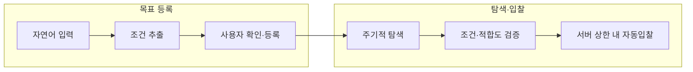

# Autique BE·AI

Autique의 백엔드와 AI 레포입니다. 중고 신발 경매 서비스의 경매·입찰·주문 API와, 사진으로 상품 정보를 채우고 시세로 가격을 제안하는 AI 기능을 함께 담고 있습니다.

## 주요 기능

| 기능 | 설명 |
| --- | --- |
| 경매·입찰 | 수동 입찰, 자동입찰(Proxy Bidding), 종료 연장, 낙찰·차순위 이양·주문 |
| AI 상품 분석 | 사진을 올리면 브랜드·모델·색상·사이즈·상태 등급을 초안으로 채웁니다 |
| AI 가격 계산 | 중고 매물 가격(당근·후르츠패밀리)과 KREAM 체결가, 상태·구성품 계수로 추천가를 계산합니다 |
| Purchase Agent | "뉴발 990 A급 15만원 이하" 같은 자연어 목표로 경매를 찾아 대신 입찰합니다 |
| 개인화 추천 | 상품 임베딩과 행동 로그(입찰·찜·조회)로 취향에 맞는 경매를 추천합니다 |

## 기술 스택

### Backend

| 기술 | 역할 |
| --- | --- |
| Java 17 | 백엔드 개발 언어 |
| Spring Boot 3.5 | REST API 및 비즈니스 로직 |
| MySQL 8.4 | 경매·입찰·주문 데이터 관리 |
| Redis / Redis Streams | 캐싱 및 비동기 메시지 큐 |

### Server & Infrastructure

| 기술 | 역할 |
| --- | --- |
| AWS EC2 | API 서버와 Worker 서버 분리 운영 (2대) |
| Docker | 컨테이너 기반 서비스 실행 |
| Amazon S3 | 상품 이미지 저장 |
| GitHub Actions | CI/CD 자동화 |
| Amazon ECR | Docker 이미지 저장 및 배포 |

### AI

| 기술 | 역할 |
| --- | --- |
| Claude Sonnet 5 | Vision 라벨 판독 (사이즈·스타일 코드, 최종 브랜드·모델명) |
| Claude Haiku 5.5 | Vision 실루엣(브랜드·모델·색상)·상태(등급·하자) 판정 |
| Anthropic Java SDK | Spring Boot에서 Claude Messages API 호출 |
| OpenAI GPT-4o-mini | Purchase Agent 자연어 Goal 파싱, 매물 적합도 Matcher (규칙 기반 구현과 교체 가능) |
| OpenAI text-embedding-3-small | 상품 임베딩(1536차원) 기반 개인화 추천 |
| Structured Outputs (JSON Schema) | 응답 스키마 강제. 값의 타당성은 서버 검증기가 따로 확인합니다 |
| Micrometer | AI 호출 지연·토큰·실패 지표 수집 |

### Data Pipeline

| 기술 | 역할 |
| --- | --- |
| Python | 크롤링·시세 캘리브레이션 |
| Requests / BeautifulSoup / Playwright | 당근·후르츠패밀리·KREAM 가격 수집 (robots.txt 준수) |
| CSV 시세 테이블 | 모델 시세 65개·색상 83개·상태/구성품 계수 (중고 매물 6,173건 기반) |

## 아키텍처

### API·Worker 구조

API 서버는 분석 완료까지 기다리지 않고 바로 응답하며, Worker 서버가 Redis Streams로 작업을 받아 별도로 분석합니다. 분석이 늦어져도 경매·입찰 요청에는 영향이 없습니다.

```
API 요청 → Redis Streams 발행 → Worker 수신 → S3 이미지 조회 → AI 분석 → MySQL 결과 저장 → 메시지 ACK
```

### 상품 분석

사진 분석은 세 단계(실루엣 / 라벨 판독 / 상태 판정)를 동시에 실행하고, 단계마다 모델을 나눠 씁니다. AI가 채운 값은 모두 **초안**입니다. 사진 근거(evidence)가 없는 값은 서버 검증기가 비우고, 빈 값이나 경고가 있으면 사용자에게 확인을 요청합니다.

```
사진 업로드 → S3(768px 분석용 사본) → Redis Streams → Vision 3단계 동시 분석
  → 근거 검증 → 사용자 확인·수정 → 시세 기반 가격 계산
```

### Purchase Agent



- **AI**: 구매 조건 해석과 매물 적합도 판정
- **사용자**: 구매 목표 확인과 결제 승인
- **서버**: 시세 계산과 입찰 상한 제한

후보 순위, 입찰 직전 시세 재계산, 미낙찰 시 재탐색, 기한 만료까지 포함한 전체 흐름은 [docs/purchase-agent/ai.md](docs/purchase-agent/ai.md#전체-동작-흐름)에 있습니다.

## 주요 설계 결정과 검증 결과

### 설계 결정

| 문제 | 선택과 이유 | 자세히 |
| --- | --- | --- |
| 동시 입찰 시 데이터 정합성 | 비관적 락(`SELECT ... FOR UPDATE`)으로 같은 경매의 변경을 직렬화. 경합 지점이 MySQL row 하나라 분산 락은 쓰지 않음 | [실험](docs/backend/experiments/concurrency/summary.md) |
| 같은 요청의 중복 처리 | 재시도 중복은 Idempotency-Key, 동시 수정은 락으로 따로 막음. 서로 대체할 수 없는 문제 | [설계 기록](docs/backend/overview.md) |
| 낙찰 결과와 실제 상태의 불일치 | 결과를 저장하지 않고 경매·주문·차순위 상태로 조회마다 계산 | [설계 기록](docs/backend/overview.md) |
| 연장된 경매의 조기 종료 | 스케줄러가 경매를 잠근 뒤 다시 읽은 최신 종료 시각으로 판정 | [설계 기록](docs/backend/overview.md) |
| 사진 분석 대기 시간 | 분석 단계 병렬 실행과 단계별 모델 분리(가벼운 판정 Haiku, 작은 글씨 판독 Sonnet) | [AI 시스템](docs/ai-system.md) |
| AI의 근거 없는 값 생성 | 초안으로만 제공하고, 근거 검증과 사용자 확인을 거침 | [Vision 설계](docs/ai-vision-agent.md) |
| 판매자 입력값에 따른 입찰 상한 왜곡 | 판매자 값 대신 서버가 다시 계산한 시세로 상한 제한 | [Purchase Agent](docs/purchase-agent/ai.md) |
| 해외 시세에 의한 가격 왜곡 | 국내 중고 매물 가격을 기준으로 하고 eBay는 참고로만 표시 | [가격 계산](docs/ai-pricing-agent.md) |
| 크롤링 차단 | 우회하지 않고 수집 중단. 이미 모은 원본을 다시 분석해 커버리지 확대 | [AI 시스템](docs/ai-system.md) |

### 검증 결과

| 항목 | 조건 | 결과 |
| --- | --- | --- |
| 입찰 정합성 | 같은 경매 동시 입찰 재현, 20회 | 락 없음 3회 위반 → 비관적 락 **0회** (응답 중앙값 27ms → 60ms) |
| Vision 분석 시간 | 실제 매물 14건, 사진 3~6장, Vision 구간만 | GPT-4o 14.9초 → **4.7초**, 등급 오답 증가 없음 |
| Vision 분석 비용 | 같은 14건 | 1건 약 $0.0175 (GPT-4o 약 $0.019와 비슷, 전 단계 Sonnet 5 대비 -64%) |
| 규칙 기반 Matcher | 실제 당근 매물 59건 | 57건 정답(약 97%), 조건에 맞지 않는 매물 통과 **0건** |
| 시세 기준 선택 | 당근 매물가 예측 오차 | KREAM 25% / KREAM·eBay 혼합 38% / eBay 155% |
| 상태 계수 | 당근 매물가 ÷ KREAM 새제품가 | 1,884건으로 등급별 계수 산출 |

- OpenAI 기반 Goal 파서·Matcher는 아직 측정하지 않았습니다. 위 Matcher 수치는 규칙 기반 구현의 결과입니다.
- 당근·후르츠패밀리 가격은 판매자가 올린 호가이고 체결가가 아닙니다. 그래서 가격 범위(IQR)를 함께 보여 줍니다.

## 시작하기

### 사전 준비

- JDK 17
- Docker (로컬 MySQL·Redis 실행용)
- Python 3.11 이상 (크롤러를 돌릴 때만, 3.11에서 테스트 확인)

### 백엔드 실행

```bash
cd backend
cp .env.example .env
docker compose -f docker-compose.local.yml up -d   # MySQL, Redis

export LOCAL_DB_PASSWORD=localpw                 # .env의 MYSQL_ROOT_PASSWORD와 같은 값
export JWT_SECRET=<32자 이상 임의 문자열>
export OPENAI_API_KEY=<OpenAI 키>
export ANTHROPIC_API_KEY=<Anthropic 키>          # 없으면 기동은 되지만 Vision 분석이 실패합니다
./gradlew bootRun --args='--spring.profiles.active=local'
```

서버는 `http://localhost:8080`에서 뜹니다. API 문서는 `http://localhost:8080/swagger-ui/index.html`, 상태 확인은 `http://localhost:8080/actuator/health`에서 볼 수 있습니다.
S3 업로드를 쓰려면 `AWS_ACCESS_KEY_ID`, `AWS_SECRET_ACCESS_KEY`, `CLOUD_AWS_S3_BUCKET`도 넣어야 합니다. 전체 환경변수는 [docs/deployment/configuration.md](docs/deployment/configuration.md)에 정리되어 있습니다.

### 크롤러 실행

```bash
cd crawler
pip install -r requirements.txt pytest
python -m pytest tests
```

> 당근마켓 수집은 2026-09-17부터 중단된 상태입니다. 검색 페이지 구조가 바뀌었고 robots.txt가 AI 크롤러를 막아, 우회하지 않고 2026-09-04 수집분을 최종 데이터로 쓰고 있습니다.

## 스크립트

| 명령 | 설명 |
| --- | --- |
| `./gradlew test` | 단위·통합 테스트 (유료 API 호출·성능 실험 제외) |
| `./gradlew test -PincludeSlowTests` | 성능 실험·실제 AI 호출 테스트까지 포함 |
| `./gradlew build` | 테스트 후 빌드 |
| `scripts/aws/deploy.sh` | API·Worker EC2 배포 (GitHub Actions가 호출) |
| `scripts/aws/smoke-analyze.sh` | 배포 후 분석 API 스모크 테스트 |
| `loadtest/k6/run-stages.sh` | 인기 경매 동시 입찰 부하 테스트 |

## 폴더 구조

| 폴더 | 내용 |
| --- | --- |
| `backend/` | Spring Boot API 서버와 비동기 분석 Worker |
| `crawler/` | 가격 수집과 시세 계수 산출 (Python) |
| `docs/` | API 계약, AI 시스템, 배포, 실험 기록 |
| `loadtest/` | k6 부하 테스트 |

```
backend/src/main/java/com/vintic/backend/
├── ai/
│   ├── vision/            # 사진 분석 (3단계 Vision, Claude/OpenAI 클라이언트)
│   ├── purchase/          # Purchase Agent (Goal 파서, Matcher, 시세 provider)
│   ├── search/            # 임베딩, 청킹
│   ├── prompt/            # 프롬프트 템플릿 로더
│   └── observability/     # AI 호출 기록·지표
├── analyze/               # 분석 요청 API, Redis Streams 큐
├── price/                 # 가격 계산
├── recommendation/        # 개인화 추천
├── auction/ bid/ autobid/ # 경매, 수동 입찰, 자동입찰
├── backupoffer/ order/    # 차순위 이양, 주문
├── penalty/ purchasegoal/ # 낙찰 포기 패널티, 구매 목표
├── auth/ user/            # 인증(JWT, 카카오), 사용자
└── common/ config/        # 공통 응답·예외, 설정

backend/src/main/resources/
├── prompts/               # Vision·Agent 프롬프트
└── data/                  # 시세 CSV, 모델 별칭 표

crawler/
├── fruitsfamily/ kream/   # 사이트별 수집기
├── calibration/           # 정제·계수 산출 (별칭, 필터, 상태·색상·구성품 계수)
└── tests/
```

## 배포

`main`으로 PR을 열면 GitHub Actions가 테스트와 빌드를 실행합니다(`pr.yml`). 배포(`deploy.yml`)는 Docker 이미지를 Amazon ECR에 올린 뒤 같은 이미지를 API EC2와 Worker EC2에 각각 배포합니다. Actions에서 수동으로 실행하거나, 저장소 변수 `AUTO_DEPLOY=true`일 때 `main` push마다 자동으로 실행됩니다.

- API EC2: `dev,api` 프로필, 앞단에 Caddy가 HTTPS를 처리합니다
- Worker EC2: `dev,worker` 프로필, 분석 큐 소비와 Vision 호출을 맡습니다

자원 구성과 비밀값 설정은 [docs/deployment/runbook.md](docs/deployment/runbook.md)를 참고하세요.

- [docs/deployment/configuration.md](docs/deployment/configuration.md) — 환경변수·프로필·포트·관리 엔드포인트 참조

**실험**
- [docs/backend/experiments/concurrency/summary.md](docs/backend/experiments/concurrency/summary.md) — 입찰 동시성 제어 실험
- [docs/backend/experiments/hot-auction-load/summary.md](docs/backend/experiments/hot-auction-load/summary.md) — 인기 경매 부하 테스트
- [docs/backend/experiments/manual-bid-smoke-test.md](docs/backend/experiments/manual-bid-smoke-test.md) — 수동 입찰 단일 요청 스모크
